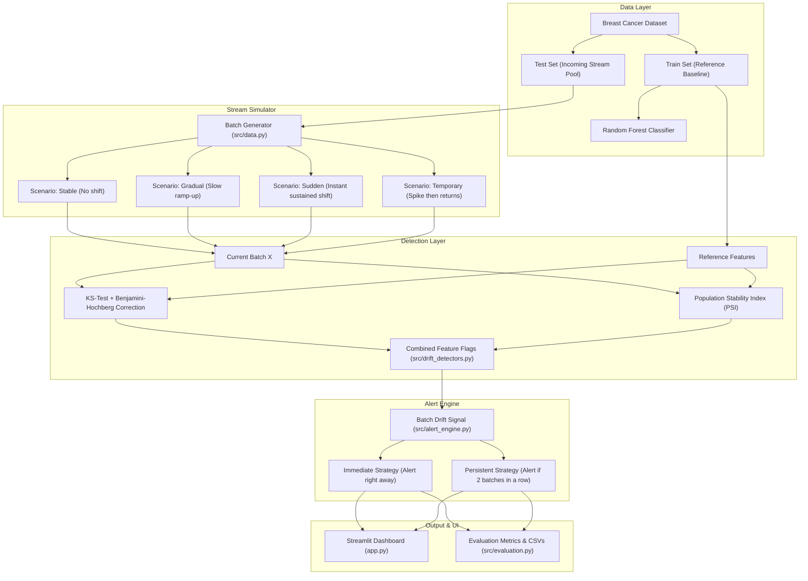

# DriftLens: Complete Project Guide (Simple & Clear Explanation)

Welcome to **DriftLens**! This guide explains the entire project in simple, plain English—breaking down the **Problem**, the **Solution**, the **Architecture**, the **Folder & File Structure**, and **All Key Terms**.

---

## 1. What is DriftLens in Simple Words?

Imagine you have a smoke alarm in your kitchen.
- If it goes off every time you make toast, you will get annoyed and eventually remove the batteries. That is **alert fatigue**.
- But if there is a real fire, you want it to warn you immediately.

**DriftLens** is like a smart monitoring system for Machine Learning models. Instead of sounding an alarm on the very first weird batch of data (which might just be temporary noise), it checks whether the change **persists across consecutive batches**. If the change stays for two batches in a row, only then does it sound the alarm.

---

## 2. The Problem

When a machine learning model is deployed in the real world:
1. **The world changes:** Customers change habits, weather changes, medical machines get recalibrated. The new data coming in looks different from the data the model was trained on. This is called **Data Drift**.
2. **Models can silently fail:** When the input data changes, the model's predictions might become inaccurate.
3. **The False Alarm Problem (The "Crying Wolf" issue):**
   - If your monitoring tool triggers an alert on *every single batch* that looks slightly unusual, 20% to 30% of your alerts will be **false alarms** caused by random sampling fluctuations.
   - Machine learning engineers end up ignoring the notifications. When real damage happens, nobody is paying attention!

---

## 3. The Solution

DriftLens introduces a **Persistence-Based Alerting Policy**:

1. **Dual Detection (Two Math Checkpoints):**
   - It doesn't rely on a single metric. It runs the **Kolmogorov–Smirnov (KS) Test** (with multiple-testing correction) AND calculates the **Population Stability Index (PSI)**.
   - A feature is only flagged if **both** tests agree that it shifted.
2. **Collapse to a Batch Signal:**
   - If at least one feature (or a configurable number of features) is flagged, the batch is marked as "drift detected".
3. **The Persistent Strategy ($k=2$):**
   - **Immediate Alert:** Alerts on batch 1 if drift is detected (fast, but produces lots of false alarms).
   - **Persistent Alert ($k=2$):** Waits to see if drift occurs again in batch 2. If batch 2 is normal, the counter resets to zero! If batch 2 is also drifting, the alarm rings.

### What did our experiments prove?
- On stable, normal data, the **immediate strategy raised false alarms on 27.8% of batches** (100% of runs had at least one false alarm!).
- The **persistent strategy dropped false alarms down to 8.5%**—a **70% reduction in false alarms**, with only a tiny delay of **0.9 batches** on real sudden drift.

---

## 4. Architecture & Workflow

Here is how data flows through DriftLens:



---

## 5. Repository Structure: What Each File Does

Here is the full repository layout and the exact responsibility of every file:

```text
DriftLens/
├── app.py                      # Interactive Streamlit Web Dashboard
├── requirements.txt            # Python dependencies (numpy, pandas, scikit-learn, etc.)
├── README.md                   # Comprehensive technical documentation & findings
├── DRIFTLENS_EXPLAINED.md      # This plain-English guide
│
├── src/                        # Core Python source code
│   ├── __init__.py             # Makes 'src' a Python package
│   ├── data.py                 # Loads data & simulates realistic drift scenarios
│   ├── model.py                # Trains baseline Random Forest & calculates accuracy/F1
│   ├── drift_detectors.py      # Computes KS-test, Benjamini-Hochberg, and PSI
│   ├── alert_engine.py         # State machine for immediate vs. persistent alerts
│   └── evaluation.py           # Calculates false-alert rate, detection delay, precision/recall
│
├── tests/                      # Automated Pytest test suite (27 unit & integration tests)
│   ├── test_alerts.py          # Tests counter resets, state immutability, toy evaluations
│   ├── test_data.py            # Tests data loading, batch shapes, and reproducibility
│   ├── test_detectors.py       # Tests drift detection across all 4 scenarios
│   ├── test_drift.py           # Tests KS adjustments, PSI bin edge cases, identical data
│   └── test_model.py           # Tests classifier training and baseline metrics (>90%)
│
├── experiments/                # Controlled research experiment runner
│   └── run_experiments.py      # Runs 20 seeds across 1,600 batches and exports CSVs
│
└── results/                    # Exported experimental data
    ├── summary.csv             # Measured false alert rates, detection rates, and delays
    ├── feature_id.csv          # Precision & recall of detecting altered features
    ├── performance.csv         # Model accuracy/F1 under shifted vs. unshifted data
    └── batch_results.csv       # Granular batch-by-batch log (1,600 rows)
```

---

## 6. Relevant Terms Explained in Simple English

| Term | What It Means (Simple Explanation) |
| :--- | :--- |
| **Data Drift (Input Drift)** | The input features coming into the model have changed in distribution (e.g., patient age or cell measurements are shifted compared to training data). |
| **Concept Drift** | The true mathematical relationship between features and labels has changed (e.g., a measurement that used to mean "benign" now means "malignant"). DriftLens detects *input drift*, not concept drift. |
| **Reference Distribution** | The "baseline" normal data that the model was originally trained on. In our project, this is `X_train`. |
| **Current Batch** | A small group of incoming data rows (e.g., 100 samples) arriving at time $t$. |
| **Kolmogorov–Smirnov (KS) Test** | A statistical test that compares the curves (CDFs) of two data distributions to see if they come from the same population. It outputs a $p$-value. |
| **p-value** | The probability that the difference we saw happened purely by random luck. If $p < 0.05$, the difference is considered statistically significant. |
| **Multiple-Testing Problem** | When you test 30 features at the same time at $\alpha = 0.05$, there is a high chance that at least 1 or 2 features will look "significant" purely by chance. |
| **Benjamini–Hochberg (BH) Procedure** | A smart mathematical correction that adjusts the $p$-values when testing multiple features simultaneously, preventing false positive flags. |
| **Population Stability Index (PSI)** | A metric commonly used in banking and ML monitoring to measure how much a feature's values have shifted between reference bins and current bins. Rule of thumb: $< 0.10$ is small/none, $> 0.25$ is significant shift. |
| **Combined Feature Flag** | A feature is only flagged if **both** the adjusted KS test says "significant" AND PSI is above threshold. |
| **Immediate Alert** | An alert strategy that sounds an alarm the instant a single batch has drift. |
| **Persistent Alert ($k=2$)** | An alert strategy that only sounds an alarm if the drift condition is met for $k$ consecutive batches. If a normal batch arrives, the counter resets. |
| **False Alert Batch Rate** | The percentage of normal, unshifted batches that triggered a false alarm. |
| **Detection Delay** | How many batches it took between when drift actually started and when the alert first triggered. |
| **Feature Identification Precision & Recall** | **Recall:** Did we catch the features we deliberately changed? (In our project: **100%** on sudden drift).<br>**Precision:** When we flagged a feature, was it actually one of the changed ones? (~**82%** in our project). |

---

## 7. The 4 Drift Scenarios Explained

In `src/data.py`, we created four realistic scenarios:

1. **Stable:**
   - Nothing is changed. Incoming batches come directly from the normal test distribution.
   - *Goal:* Test how often detectors raise false alarms when everything is fine.
2. **Gradual Drift:**
   - Shift starts small and increases slowly with each batch (e.g., a sensor slowly degrading over weeks).
   - *Goal:* Measure how quickly the system detects a slow creep in values.
3. **Sudden Drift:**
   - At batch 8, an instant large shift occurs and stays until the end (e.g., new software update or hospital sensor replacement).
   - *Goal:* Test how fast the alert engine responds to an abrupt change.
4. **Temporary Shift (Spike):**
   - At batch 8, a shift occurs for 4 batches, then returns back to normal baseline (e.g., a temporary power fluctuation or holiday surge).
   - *Goal:* Verify that the persistence counter correctly resets to zero after the anomaly passes.

---

## 8. What the Experimental Results Mean

When you run `python experiments/run_experiments.py`, it tests **20 different random seeds** (1,600 total batches). Here is what the real data proved:

```text
Scenario: Stable (Clean Data)
- Immediate Alert Strategy:  27.8% false alarm rate (100% of runs had false alarms)
- Persistent Alert Strategy:  8.5% false alarm rate (70% reduction in noise!)

Scenario: Sudden Drift
- Immediate Alert Strategy:  Triggers at delay 0.0 batches, but with 24.3% false alarms
- Persistent Alert Strategy:  Triggers at delay 0.9 batches (waits for batch 2), with only 7.1% false alarms and 100% detection rate!
```

**The Takeaway:**
Requiring just **two consecutive batches** eliminates nearly three-quarters of false alarms, with less than 1 batch of delay!

---

## 9. How to Run Everything

### Step 1: Run the Automated Unit Tests
```powershell
.\.venv\Scripts\python.exe -m pytest
```
*Expected output:* `27 passed in ~3.5 seconds`.

### Step 2: Run the Experiments
```powershell
.\.venv\Scripts\python.exe experiments/run_experiments.py
```
*Generates real CSV files in the `results/` folder.*

### Step 3: Launch the Streamlit Interactive Dashboard
```powershell
.\.venv\Scripts\python.exe -m streamlit run app.py
```
*Open your browser at `http://localhost:8501`:*
- Use the **Next batch** button to watch batches flow one by one.
- Watch the **Consecutive drift batches** counter count up or reset to zero.
- Compare the **Immediate Alert** (red ALERT) vs. **Persistent Alert** (green OK until 2 consecutive batches).
- Inspect feature histograms and PSI charts interactively.
- Switch to the **Experiment results** tab to see the final comparison tables.
